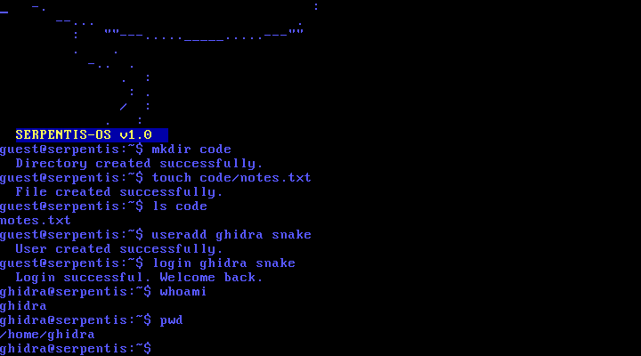
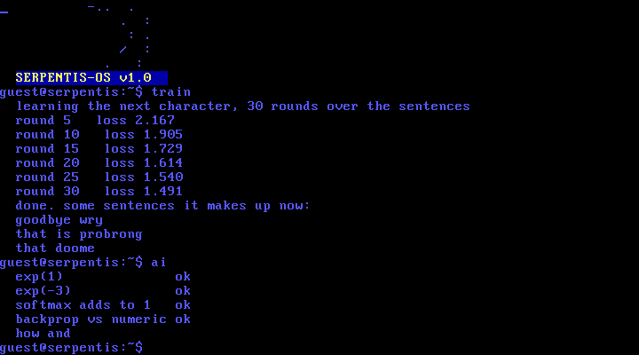

serpentis32

the 32 bit version of my os, before it went 64 bit. one flat binary in fasm, a boot sector that loads it, and a shell on the vga text screen

## what is in it

a shell with page up and page down scrollback. files and directories on the disk that survive a reboot, mkdir cd ls touch cp mv rm rmdir cat pwd, all of them take paths. users with useradd login logout whoami, the passwords are stored as half a sha-256 of name:password and never as typed. an editor (open file.txt, arrows to move, f2 saves, esc goes back) that scrolls once the file is longer than the screen. snake (serpen), pong (pongi) and an isometric world in 320x200 (open game). help lists everything

the ai folder is a small neural network in x87 assembly. it looks at the two previous characters and learns which one comes next, an embedding, one hidden layer with tanh and a softmax over 32 characters, backprop written out by hand. train runs 30 rounds over the sentences in ai/data/english_dataset.asm, the loss goes from about 2.2 down to 1.5, and then it makes up a few sentences of its own. ai checks the math first, exp, the softmax and the backprop against a numeric gradient, and once it is trained it finishes "how a" for you

it is tiny on purpose, about 2000 weights, so training takes seconds even in qemu. what it writes is mostly real words glued into nonsense, which is about what you get from two characters of memory

## download and try it

no need to build anything to try it. every release has the disk image ready

    curl -LO https://github.com/ghidra-devos/serpentis32/releases/latest/download/serpentis32.img

qemu, on windows, linux or mac

    qemu-system-i386 -m 128M -drive file=serpentis32.img,format=raw,if=ide -boot c

on linux add -accel kvm and on windows -accel whpx if you have it

virtualbox. download serpentis32.vdi, make a new vm with type Other and version Other/Unknown, 128 MB of memory, and when it asks for a hard disk pick use an existing disk and point it at the vdi. it has to sit on the IDE controller. or all of it in one go

    VBoxManage createvm --name serpentis32 --ostype Other --register
    VBoxManage modifyvm serpentis32 --memory 128
    VBoxManage storagectl serpentis32 --name IDE --add ide
    VBoxManage storageattach serpentis32 --storagectl IDE --port 0 --device 0 --type hdd --medium serpentis32.vdi
    VBoxManage startvm serpentis32

## building

you need fasm. build.sh assembles the boot sector and the kernel and glues them into a 10 MB disk image, the same one that is in the release

    ./build.sh
    qemu-system-i386 -m 128M -drive file=build/serpentis32.img,format=raw,if=ide -boot c

## how it boots

boot.asm is the boot sector. it reads 512 sectors with the int 13h extensions in four 64 KB pieces, turns on a20, loads a flat gdt and jumps to 0x10000 in 32 bit mode. karnel.asm sets up the idt, the pic, reads the filesystem and drops into the shell. after that everything happens in the keyboard interrupt, every mode (shell, editor, games) has its own key handler

## the filesystem

a table of 64 entries with a name, a size and a parent, and 4 KB of data per file. the whole table and all the files get read at boot and written back on every change. small and dumb, but there is nothing to get out of sync. /home/guest is made on a fresh disk. the file contents sit at 2 MB in memory, the kernel image is too small to hold them

## what is not great

64 files of 4 KB each, that is the whole disk. the timer is not used, nothing runs on its own. the editor has no search and no undo. open -code shows a short piece of the real code, the kernel itself is way bigger than one file
